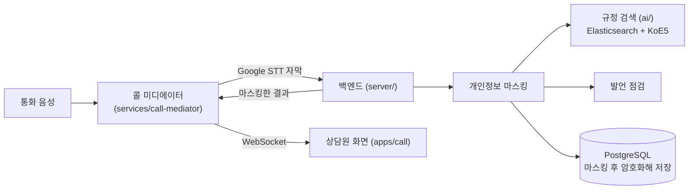

# CallGuard

120 다산콜센터 상담원이 통화하는 동안 고객의 말을 자막으로 띄우고, 그 민원에 필요한 규정과 구비서류를 옆 화면에 자동으로 보여 주는 서비스입니다.

포트폴리오 소개 페이지: https://callguard.jangminseok.com <br>
서비스 소개: https://solidbob.cloud <br>
상담원 화면 시연: https://call.solidbob.cloud (브라우저 안에서만 동작하는 시연 화면이라 실제 통화 내용이 서버로 가지 않습니다) <br>
팀 문서 사이트: https://docs.solidbob.cloud <br>
상태: 개발 기간이 끝났습니다.

[](https://github.com/jangminseok-dev/call.solidbob.cloud/actions/workflows/test.yml)

> 이 저장소는 4인 팀 프로젝트의 최종 코드를 개인 계정으로 옮긴 사본입니다. 원본 저장소 [SeongYuna/call.solidbob.cloud](https://github.com/SeongYuna/call.solidbob.cloud)의 `server` 브랜치(2026-10-19)를 기준으로 했습니다. 팀의 커밋 기록, PR, 운영 배포 기록은 원본 저장소에 있습니다.

## 한눈에 보기

| 항목 | 내용 |
|---|---|
| 기간 | 2026-08-20 ~ 2026-10-27 (1주 1스프린트, 8스프린트) |
| 인원과 역할 | 4인 팀입니다. 백엔드와 AI를 팀원 한 명과 나눠 맡았고, 저는 요청이 흐르는 백엔드 쪽(`server/`)을 담당했습니다. |
| 상태 | 개발 기간 종료 |
| 주요 기술 | Python 3.13, FastAPI, PostgreSQL, Elasticsearch 9 + nori, KoE5 임베딩, Google STT, WebSocket, React, k3s, AWS, import-linter |

## 주요 기능

- **필요한 서류 자동 추천**: 고객의 말이 한 문장으로 끝나면 그 민원에 맞는 다산콜센터 규정과 구비서류를 찾아 카드로 띄웁니다. 상담원이 따로 검색하지 않아도 됩니다.
- **개인정보 자동 가림**: 자막에 주민번호, 전화번호, 카드번호, 주소가 나오면 검색과 저장 전에 마스킹합니다. 상담원 화면에는 원문을 보여 주되 개인정보 자리를 강조하고, 저장하는 자막은 한 번 더 암호화합니다.
- **실시간 자막**: Google 음성 인식으로 통화를 자막으로 바꾸고, 고객과 상담원의 말을 나눠 보여 줍니다.
- **상담 발언 점검**: "무조건 환불됩니다"처럼 약속하면 안 되는 표현이나 빠뜨린 필수 안내를 찾아 상담원에게 알려 주고, 바꿔 말할 표현을 제안합니다.
- **통화 후 정리**: 통화가 끝나면 상담 내용을 요약하고 후속 조치 항목을 뽑습니다. 리포트도 개인정보가 마스킹된 상태로 만들어집니다.
- **상담원 보호**: 고객이 폭언하면 보호 알림과 대응 방법을 바로 띄웁니다. 폭언이 반복되면 상담원이 블랙리스트 등록을 요청하고, 관리자가 기록과 사유를 보고 승인합니다.
- **다시 건 고객 브리핑**: 같은 번호로 다시 전화가 오면, 상담원이 받기 전에 지난 통화의 주의 사항을 먼저 보여 줍니다.

## 구조



통화 음성은 자막이 되어 백엔드로 들어오고, 백엔드는 먼저 개인정보를 마스킹한 뒤에야 문서 검색, 발언 점검, 저장으로 넘깁니다. 마스킹 기능이 준비되지 않으면 백엔드는 자막을 아예 받지 않습니다.

통화 중 자막은 20초 동안 199번이나 바뀝니다. 바뀔 때마다 검색하면 서버가 버겁고 화면의 카드도 계속 흔들려서, 고객의 한 문장이 끝났을 때만 검색합니다.

| 경로 | 내용 |
|---|---|
| `server/` | 요청이 흐르는 백엔드입니다. 기능 모듈끼리는 가운데 `hub` 모듈에 정해 둔 약속(포트와 DTO)만 봅니다. |
| `ai/` | 청킹, 검색, 리랭크, 모델 학습, 평가 하네스입니다. 서비스가 아니라 라이브러리라서 `server`와 한 컨테이너로 배포했습니다. |
| `apps/` | 상담원 화면(`call`), 관리자 화면(`admin`), 소개 페이지(`platform`)입니다. |
| `services/call-mediator/` | 통화 음성을 받아 음성 인식으로 넘기고 자막을 백엔드로 보내는 중계 서버입니다. |
| `flutter/` | 관리자용 모바일 앱입니다. |
| `infra/` | 서버 이미지, nori를 넣은 Elasticsearch 이미지, k3s 매니페스트입니다. |
| `db/` | 스키마(`schema.sql`)와 ERD입니다. |
| `knowledge-base/`, `golden-set/` | 다산콜센터 규정 문서와, 정답을 정해 둔 평가 문항(골든셋)입니다. |
| `_project/decisions/` | 설계를 정할 때마다 번호를 붙여 남긴 결정 기록 127개입니다. |
| `jekyll/` | 팀 문서 사이트(https://docs.solidbob.cloud)의 원본입니다. |

## 제가 맡은 일

- 백엔드 뼈대 설계와, 모듈 경계를 강제하는 import-linter 규칙
- 개인정보 마스킹 기능의 첫 구현과, 말하는 도중 자막의 숫자 마스킹 (이름과 주소 규칙 보강은 팀원)
- 상담원 화면은 원문으로, 저장하는 자막은 마스킹한 뒤 AES-256-GCM으로 암호화하도록 바꾼 설계와 구현 (운영 반영은 팀원)
- 자막에서 검색, 추천 카드까지 이어지는 흐름 연결
- 팀원이 만든 WebSocket 게이트웨이 확장
- 평가 결과를 DB에 남기는 기록 체계
- 통화 기록, 블랙리스트, 상담원 인증 API와, 로그인 없이 들어온 요청을 돌려보내는 인증 검사
- 규정 문서를 조항 단위로 나누는 청킹과, 한국어 형태소 분석기(nori)를 넣은 Elasticsearch 이미지
- AWS 운영 인프라 설계와 구축 절차서([`docs/infra-runbook.md`](docs/infra-runbook.md)). 구축과 자동 배포는 팀원이 맡았습니다.

팀원이 맡은 일은 검색 방식 비교 측정과 검색 시점 규칙, 이름과 주소를 찾는 NER 모델, 운영 서버 구성과 CI, 화면 개발입니다.

대표 코드는 다음과 같습니다.

- 개인정보 탐지 규칙: [`server/apps/masking/domain/services/pii_detector.py`](server/apps/masking/domain/services/pii_detector.py)
- 한글로 읽은 숫자를 아라비아 숫자로 바꾸는 코드: [`server/apps/masking/domain/services/number_normalizer.py`](server/apps/masking/domain/services/number_normalizer.py)
- 말하는 도중 자막의 숫자 마스킹: [`server/apps/masking/domain/services/interim_digit_guard.py`](server/apps/masking/domain/services/interim_digit_guard.py)

## AI와 함께 만든 방식

Claude Code와 함께 개발했습니다. 사람은 무엇을 만들지와 어디까지 허용할지를 정하고, 결과는 테스트와 자동 검사로 확인했습니다.

- **규칙 문서로 에이전트를 묶었습니다.** 루트와 `server/`, `ai/`, `infra/`에 `CLAUDE.md`를 두고, 모듈 경계와 비밀값 처리 같은 규칙을 적어 에이전트가 작업 전에 읽게 했습니다.
- **결정은 문서로 남겼습니다.** 설계를 정할 때마다 번호를 붙인 결정 기록을 `_project/decisions/`에 남겼고, 코드 주석이 그 번호를 근거로 가리킵니다.
- **AI가 쓴 코드는 세 가지로 검증했습니다.** 모듈 사이 규칙은 import-linter가, 기능은 백엔드 테스트가, 품질은 골든셋 평가가 확인합니다. 규칙 검사와 테스트는 CI에서도 실행되어 사람이 놓쳐도 머지 전에 걸립니다.

## 검증

| 영역 | 무엇으로 확인하나 | 결과 (2026-11-18, 이 사본에서 실행) |
|---|---|---|
| 백엔드 | pytest 단위 테스트 | 1,498개 통과, 1개 건너뜀 |
| 백엔드 DB | 실제 PostgreSQL에 붙는 통합 테스트 | CI에서 실행 (33개) |
| 검색과 평가 | pytest | 608개 통과 |
| 통화 판정 | 합성 통화 판정 테스트 | 33개 통과 |
| 구조 | import-linter 계약 (백엔드 5종, ai 3종) | 8종 모두 지킴 |

골든셋으로 측정한 결과는 다음과 같습니다.

- 놓친 개인정보: 제가 마스킹을 구현한 날, 골든셋의 마스킹 문항 10건에서 3건에서 0건으로 줄었습니다. 팀원이 규칙을 보강한 뒤의 최종 측정(문항 36개, 개인정보 패턴 40개)에서도 0건이었습니다.
- 검색 정확도(Recall@5): 키워드 검색만 쓸 때 0.853, 벡터 검색을 쓸 때 0.971이었습니다(팀원 측정). 그래서 기획안의 하이브리드 검색을 빼고 벡터 검색을 택했습니다.

GitHub Actions의 [`test.yml`](.github/workflows/test.yml)이 푸시마다 백엔드, ai, 문서 사이트, 콜 미디에이터, 화면 검사를 실행합니다. 배포 워크플로(`pages.yml`, `release.yml`)는 이 사본에서는 수동 실행으로만 두었습니다.

## 데이터 출처

이 프로젝트의 골든셋 일부, 음성 인식 실측, 숙련도별 WER은 AI Hub(한국지능정보사회진흥원) 사업결과인 「다산콜센터 민원 상담 음성」과 「외국인 한국어 발화 음성」(71479)을 이용해 만들었습니다. AI Hub 이용정책에 따라 원문 데이터는 저장소에 싣지 않았고(`data/raw/`는 커밋하지 않음, 골든셋은 바꿔 씀), 2차 저작물에도 같은 출처를 표기합니다.

## 시작하기

필요한 것: Python 3.13. 문서 사이트를 보려면 Ruby와 Bundler가 필요합니다.

```bash
# 백엔드 (server/ 에서)
pip install -r requirements.txt
pytest
PYTHONPATH=apps lint-imports --config .importlinter

# 검색과 평가 (ai/ 에서)
pip install -r requirements.txt
pytest
PYTHONPATH=apps:../server/apps lint-imports --config .importlinter

# 문서 사이트 (jekyll/ 에서)
bundle exec jekyll serve --host 0.0.0.0 --port 4000
```

환경 변수 목록은 [`.env.example`](.env.example)에 있습니다. 운영 구성과 배포 절차는 [`docs/infra-runbook.md`](docs/infra-runbook.md)에 있습니다.
